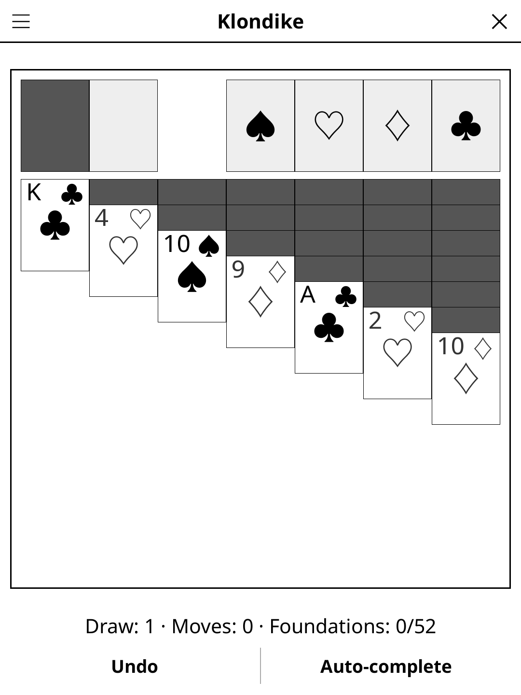
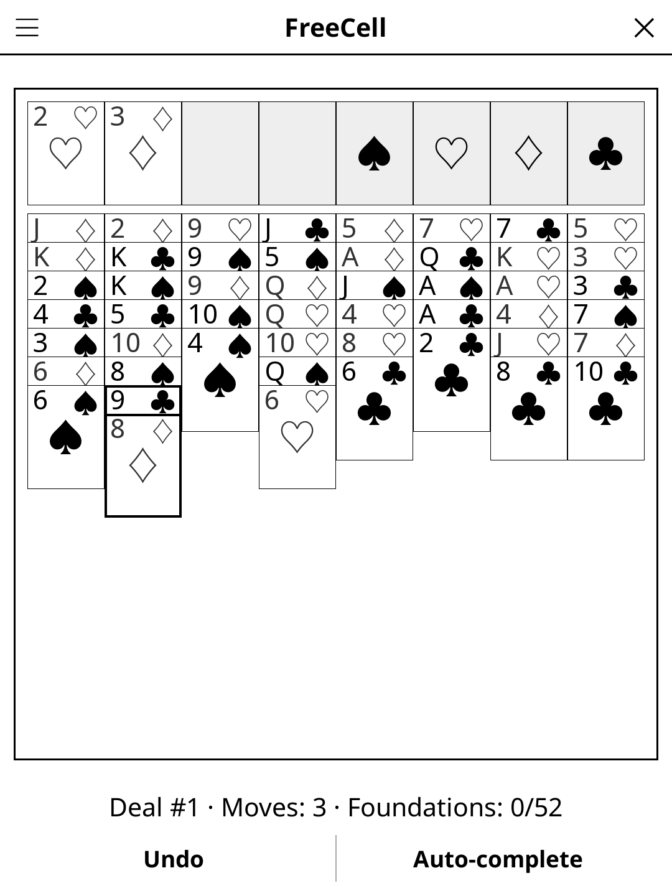
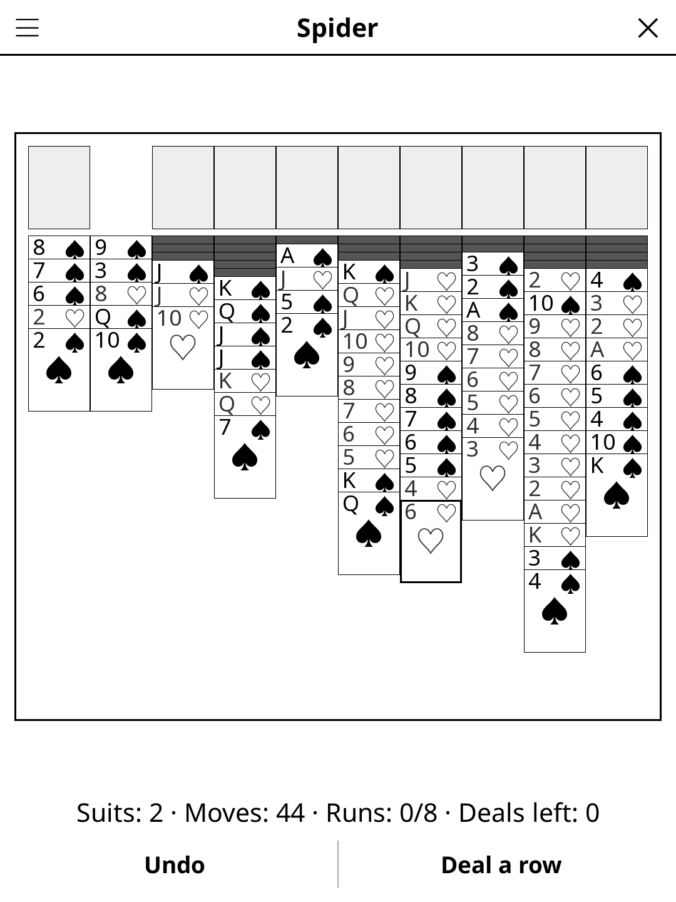
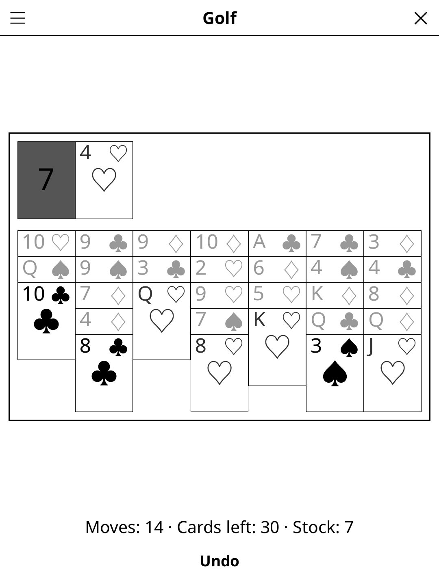
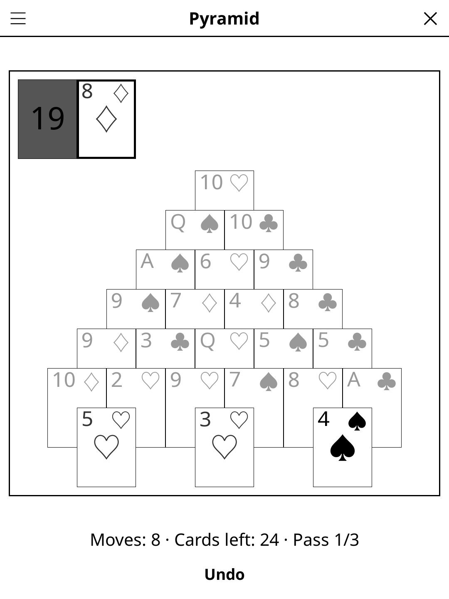

# solitaire.koplugin

Five patience games for [KOReader](https://github.com/koreader/koreader):
Klondike, FreeCell, Spider, Golf and Pyramid.

## Screenshots

| Klondike | FreeCell | Spider |
|---|---|---|
|  |  |  |

| Golf | Pyramid |
|---|---|
|  |  |

## Games

Pick one with **Game** in the title-bar menu. Each game keeps its own game in
progress, so switching back and forth resumes where you left off. Klondike is
the default.

- **Klondike** -- build the four foundations up from Ace to King, one suit
  each. Tableau columns build down in alternating colours; draw from the stock
  when stuck. Draw 1 or Draw 3.
- **FreeCell** -- all 52 cards face up in 8 columns, plus 4 free cells that
  hold one card each. Runs move as a whole when there is room to shuffle them
  through the free cells and empty columns: (free cells + 1) x 2^(empty
  columns). Deals are numbered 1-32000 and match Microsoft FreeCell's, so
  **Choose deal** replays a known one. Almost every deal is winnable (#11982
  is the famous exception).
- **Spider** -- two decks in 1, 2 or 4 suits, 10 columns. Any card goes on
  one rank higher, but only same-suit runs move together; a complete King-to-Ace
  run of one suit leaves the table by itself. Deal a new row from the stock
  when no column is empty. Face-down cards are drawn as thin edges and long
  columns squeeze together so they always fit the screen.
- **Golf** -- 7 columns of 5. Play column tops onto the waste one rank up or
  down, any suit; Kings and Aces don't connect unless **Wrap K–A** is on. One
  tap on a column plays it.
- **Pyramid** -- remove pairs adding up to 13 (J = 11, Q = 12), Kings alone,
  from a 7-row pyramid and the waste. Covered cards are greyed out. The stock
  can be gone through 1, 2, 3 times or without limit (**Passes**).

## Features

- **Five games** with their own rules page, option and saved game
- **Undo**, and **Auto-complete** in Klondike and FreeCell
- **Double-tap** a card to send it to its foundation (Klondike, FreeCell)
- **Statistics** -- games played and won per game (Spider per suit count)
- **Move counter** and per-game status line
- **Auto-save** -- every game in progress restored on next launch; saves from
  earlier versions load as the Klondike game they are

## Controls

| Action | How |
|--------|-----|
| Move a card or a run | Tap the source, then the destination |
| Draw / deal from the stock | Tap the stock pile (Spider: also **Deal a row**) |
| Golf: play a card | Tap its column |
| Pyramid: remove a pair | Tap both cards (a King: tap it once) |
| Auto-complete | Tap **Auto-complete** (Klondike, FreeCell) |
| Undo last move | Tap **Undo** |
| New game | Menu → **New game** |
| Switch game | Menu → **Game** |
| Game option | Menu → **Draw** / **Choose deal** / **Suits** / **Wrap K–A** / **Passes** |
| Statistics | Menu → **Statistics** |

## Installation

1. Download `solitaire.koplugin.zip` from the [latest release](../../releases/latest).
2. Extract into the `plugins/` folder of your KOReader data directory.
3. Restart KOReader.
4. Open the menu → **Tools** → **Solitaire**.

## License

GPL-3.0 — see [LICENSE](LICENSE).
